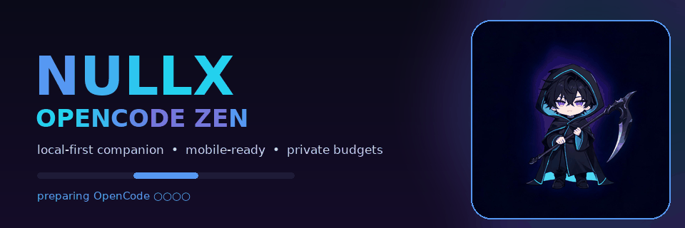

<p align="center">
  
</p>

<p align="center">
  <a href="https://github.com/Inkflow-Gab/NullxOpenCodeZen/actions/workflows/ci.yml"></a>
  
  
  
</p>

<h1 align="center">Nullx OpenCode Zen</h1>

<p align="center"><b>A local-first, animated companion CLI for the official <a href="https://github.com/anomalyco/opencode">OpenCode</a> coding agent.</b></p>

Nullx OpenCode Zen is an educational project for learning CLI design, cross-platform process management, pinned dependency installation, and local usage budgeting. It wraps the official `opencode` executable instead of replacing it.

- 🔎 Detect an existing OpenCode installation, or install a pinned official npm release.
- 🌈 Show a clean violet/cyan connection-preparation animation on TTYs, with plain fallbacks.
- 📱 Support Ubuntu inside Termux `proot-distro` using **no `sudo` commands**.
- 🧮 Enforce local daily launch budgets for one-shot runs and interactive sessions.
- 🔒 Keep a private, prompt-free launch journal with timezone-aware rollover.
- 🎯 Select a default `provider/model` and delegate authentication to OpenCode.
- ⚡ Install everything with one animated `bash scripts/setup.sh` — no `sudo`, no name collisions.
- 🩺 Run environment-aware diagnostics, including proot/WSL hints, command shadowing, and binary candidate reporting.
- 🗡️ Ship a shadow-and-scythe mascot, animated README banner, and large/compact ASCII art.

> [!IMPORTANT]
> **Quota boundary:** Nullx budgets are local launch counters. They are **not** OpenCode Zen account quotas, token balances, or billing controls. This project does not rotate IPs, hop networks, cycle accounts, or bypass provider limits.

## 🚀 Pick your setup

| Platform | One command | Manual guide |
| --- | --- | --- |
| 📱 Android / Termux / proot Ubuntu | `bash scripts/setup.sh` | [Mobile proot guide](docs/MOBILE-PROOT.md) |
| 🐧 Ubuntu / Linux desktop | `bash scripts/setup.sh` | [Ubuntu setup](#-ubuntu--linux-desktop) |
| 🪟 Windows PowerShell | `pwsh scripts/setup.ps1` | [Windows setup](#-windows-powershell) |

## ⚡ All-in-one setup (one copy-paste)

Already inside Ubuntu — desktop, WSL, or proot on your phone? Paste this **one** block:

```bash
git clone https://github.com/Inkflow-Gab/NullxOpenCodeZen.git "$HOME/NullxOpenCodeZen" 2>/dev/null; cd "$HOME/NullxOpenCodeZen" && bash scripts/setup.sh
```

Already cloned? Then it is just:

```bash
bash scripts/setup.sh
```

Windows PowerShell:

```powershell
pwsh -ExecutionPolicy Bypass -File scripts/setup.ps1
```

The script shows ASCII art, a spinner, and a live progress bar, then does all of this for you:

| Step | What happens |
| --- | --- |
| 1 | Detect platform, architecture, and proot/Termux environment |
| 2 | Clone or update the repository |
| 3 | Install Node 22+ into your home directory — **no `sudo`** |
| 4 | Install locked dependencies (`npm ci`) |
| 5 | Build the CLI |
| 6 | Install the launcher, update `PATH`, write config, and install OpenCode |

```text
[1/6] ████░░░░░░░░░░░░░░░░░░░░ ⠹ Ensuring Node 22+
✔ [2/6] ████████░░░░░░░░░░░░░░░░ Preparing repository — cloned
✔ [3/6] ████████████░░░░░░░░░░░░ Ensuring Node 22+ — node v22.22.3
```

### 🛡️ Name collisions are handled, never clobbered

If another program already owns the `nullx` command, setup installs this project as **`nullx-zen`** and leaves the other tool untouched. No `EEXIST`, no `npm link --force`, no lost binaries.

```text
Notes
  • Another program already owns "nullx", so this project installed "nullx-zen" instead. Both tools keep working.
```

Useful flags:

```bash
bash scripts/setup.sh --name nz            # pick your own command name
bash scripts/setup.sh --force              # take over `nullx`, backing up the old one
bash scripts/setup.sh --skip-opencode      # CLI only, install OpenCode later
bash scripts/setup.sh --no-animation       # plain output for logs and CI
```

Hit `npm error EEXIST` from `npm link`? See [Troubleshooting](docs/TROUBLESHOOTING.md) — the fix is `bash scripts/setup.sh`.

## 🧩 Manual setup, step by step

Prefer to see every command? Each step below is its own copy-paste block. Run them in order.

## 📱 Mobile: Ubuntu in proot, no sudo

Start in **Termux**, not inside Ubuntu yet.

### 1. Update Termux

```bash
pkg update -y
```

### 2. Install proot-distro

```bash
pkg install -y proot-distro
```

### 3. Install Ubuntu

```bash
proot-distro install ubuntu
```

If your proot-distro version requires an explicit image tag, use this instead:

```bash
proot-distro install ubuntu:24.04 --name ubuntu
```

### 4. Enter Ubuntu

```bash
proot-distro login ubuntu
```

Now you are inside Ubuntu. The remaining commands do **not** use `sudo`.

### 5. Update Ubuntu packages

```bash
apt update
```

### 6. Install build and session tools

```bash
apt install -y curl git ca-certificates xz-utils nodejs npm tmux
```

### 7. Use a user-writable npm prefix

```bash
npm config set prefix "$HOME/.local"
```

### 8. Create the local bin directory

```bash
mkdir -p "$HOME/.local/bin"
```

### 9. Add it to PATH for this session

```bash
export PATH="$HOME/.local/bin:$PATH"
```

### 10. Make PATH persistent

```bash
echo 'export PATH="$HOME/.local/bin:$PATH"' >> "$HOME/.bashrc"
```

### 11. Install the Node version manager locally

```bash
npm install -g n
```

### 12. Keep Node installs under your home directory

```bash
export N_PREFIX="$HOME/.local"
```

### 13. Make N_PREFIX persistent

```bash
echo 'export N_PREFIX="$HOME/.local"' >> "$HOME/.bashrc"
```

### 14. Install Node 22

```bash
n 22
```

### 15. Refresh the shell command cache

```bash
hash -r
```

### 16. Verify Node

```bash
node --version
```

### 17. Verify npm

```bash
npm --version
```

### 18. Clone Nullx

```bash
git clone https://github.com/Inkflow-Gab/NullxOpenCodeZen.git
```

### 19. Enter the project

```bash
cd NullxOpenCodeZen
```

### 20. Install locked dependencies

```bash
npm ci
```

### 21. Build the CLI

```bash
npm run build
```

### 22. Expose the `nullx` command

```bash
node dist/cli.js setup --skip-opencode
```

This installs a launcher into `~/.local/bin` and updates `PATH`. If another program already owns `nullx`, it installs `nullx-zen` instead and prints the name it chose.

> [!TIP]
> `npm link` fails with `EEXIST` when another tool already provides `nullx`. Use `setup` instead — it never clobbers the other program. See [Troubleshooting](docs/TROUBLESHOOTING.md).

### 23. Verify Nullx

```bash
nullx --version
```

### 24. Install OpenCode

```bash
nullx install
```

### 25. Authenticate with your own provider account

```bash
nullx auth login
```

### 26. List available models

```bash
nullx models
```

### 27. Set a default model

Replace `provider/model` with an exact ID printed by the previous command.

```bash
nullx model set provider/model
```

### 28. Run diagnostics

```bash
nullx doctor --verbose
```

### 29. Start OpenCode

```bash
nullx start
```

### Keep OpenCode open in another session

Use `tmux` so OpenCode can stay open while you use another pane or window.

```bash
tmux new -s nullx
```

Inside tmux:

```bash
nullx start
```

Then press `Ctrl-b` followed by `c` to create another tmux window. In the new window:

```bash
nullx status
```

Press `Ctrl-b` followed by `d` to detach. Reattach later:

```bash
tmux attach -t nullx
```

More detail: [docs/MOBILE-PROOT.md](docs/MOBILE-PROOT.md).

## 🐧 Ubuntu / Linux desktop

### 1. Update packages

```bash
sudo apt update
```

### 2. Install prerequisites

```bash
sudo apt install -y curl git ca-certificates xz-utils nodejs npm
```

### 3. Check Node

```bash
node --version
```

If Node is older than 22, install `n`:

```bash
sudo npm install -g n
```

Then install Node 22:

```bash
sudo n 22
```

Refresh the shell:

```bash
hash -r
```

### 4. Clone Nullx

```bash
git clone https://github.com/Inkflow-Gab/NullxOpenCodeZen.git
```

### 5. Enter the project

```bash
cd NullxOpenCodeZen
```

### 6. Install locked dependencies

```bash
npm ci
```

### 7. Build

```bash
npm run build
```

### 8. Install the command

```bash
node dist/cli.js setup --skip-opencode
```

Setup installs a launcher into `~/.local/bin`, updates `PATH` idempotently, and falls back to `nullx-zen` if another program already owns `nullx`.

Open a new shell, or:

```bash
exec $SHELL
```

You can always use the built entry point directly:

```bash
node dist/cli.js --help
```

### 9. Install OpenCode

```bash
nullx install
```

### 10. Authenticate

```bash
nullx auth login
```

### 11. List models

```bash
nullx models
```

### 12. Set a default model

```bash
nullx model set provider/model
```

### 13. Start

```bash
nullx start
```

## 🪟 Windows PowerShell

### 1. Install Node.js LTS

```powershell
winget install --id OpenJS.NodeJS.LTS -e
```

### 2. Install Git

```powershell
winget install --id Git.Git -e
```

Close and reopen PowerShell.

### 3. Verify Node

```powershell
node --version
```

### 4. Verify npm

```powershell
npm --version
```

### 5. Clone Nullx

```powershell
git clone https://github.com/Inkflow-Gab/NullxOpenCodeZen.git
```

### 6. Enter the project

```powershell
Set-Location NullxOpenCodeZen
```

### 7. Install locked dependencies

```powershell
npm ci
```

### 8. Build

```powershell
npm run build
```

### 9. Install the command

```powershell
node dist/cli.js setup --skip-opencode
```

Setup installs a `.cmd` launcher under `%LOCALAPPDATA%\nullx-opencode-zen\bin` and adds it to your user `PATH`. Open a new PowerShell window afterwards.

### 10. Install OpenCode

```powershell
nullx install
```

### 11. Authenticate

```powershell
nullx auth login
```

### 12. List models

```powershell
nullx models
```

### 13. Set a default model

```powershell
nullx model set "provider/model"
```

### 14. Start

```powershell
nullx start
```

## 🌈 Animation and color

On interactive terminals, `nullx start`, `nullx run`, `nullx auth`, `nullx models`, `nullx stats`, and non-JSON installs show a gradient preparation animation. It says it is **trying** to connect through OpenCode; it does not claim a Zen connection was verified.

Disable animation:

```bash
nullx --no-animation start
```

Disable color:

```bash
nullx --no-color status
```

Print the large mascot:

```bash
nullx mascot --large
```

Print the compact mascot:

```bash
nullx mascot --compact
```

Plain ASCII fallback:

```bash
nullx --no-color mascot --compact
```

## 🧮 Daily budgets

Defaults are **30 runs/day**, **10 interactive sessions/day**, and a warning at **80%**. These are local guardrails, not provider quota measurements.

Show budget:

```bash
nullx budget
```

Set limits:

```bash
nullx budget set --runs 40 --sessions 12 --timezone Asia/Manila
```

Change warning threshold:

```bash
nullx budget set --warn-at 75
```

Remove local limits:

```bash
nullx budget set --runs unlimited
```

Reset today's local counters:

```bash
nullx budget reset --yes
```

## 🧰 Commands

| Command | Purpose |
| --- | --- |
| `nullx install [--channel v1\|v2] [--repair] [--dry-run]` | Detect or install a pinned official OpenCode CLI |
| `nullx start [opencode options]` | Launch the TUI under the local session budget |
| `nullx run [opencode run options] "prompt"` | Launch one non-interactive run under the local run budget |
| `nullx auth [login\|list\|logout ...]` | Delegate to OpenCode authentication |
| `nullx models [options]` | List models through OpenCode |
| `nullx model set <provider/model>` | Set the wrapper's default model |
| `nullx stats [options]` | Show OpenCode's own usage statistics |
| `nullx budget [status\|set\|reset]` | Inspect or change local daily launch limits |
| `nullx history [--limit 20] [--json]` | Show local launch metadata |
| `nullx status [--json]` | Show the local dashboard |
| `nullx doctor [--json] [--verbose]` | Check environment, runtime, binary candidates, config, storage, and budgets |
| `nullx mascot [--large\|--compact]` | Print ASCII mascot art |
| `nullx about` | Show project information and mascot |

Full reference: [docs/COMMANDS.md](docs/COMMANDS.md).

## 🔧 Repair and detection

Repair a managed install and clean stale staging artifacts:

```bash
nullx install --repair
```

Increase transient retry attempts:

```bash
nullx install --retries 4
```

Inspect binary candidates:

```bash
nullx doctor --verbose
```

Binary precedence is:

1. `NULLX_OPENCODE_BINARY`
2. `binaryPath` in the wrapper config
3. The managed install receipt
4. The system `PATH`

## 🔒 Storage and privacy

The journal stores timestamps, launch kind, selected model, exit status, signal, and duration. It does **not** store prompts, source code, API keys, or provider responses. OpenCode maintains its own sessions and credentials separately.

| Platform | Config | State | Managed tools |
| --- | --- | --- | --- |
| Linux | `${XDG_CONFIG_HOME:-~/.config}/nullx-opencode-zen` | `${XDG_STATE_HOME:-~/.local/state}/nullx-opencode-zen` | `${XDG_DATA_HOME:-~/.local/share}/nullx-opencode-zen` |
| Windows | `%APPDATA%\nullx-opencode-zen` | `%LOCALAPPDATA%\nullx-opencode-zen\state` | `%LOCALAPPDATA%\nullx-opencode-zen\data` |
| macOS | `~/Library/Application Support/nullx-opencode-zen/config` | `~/Library/Application Support/nullx-opencode-zen/state` | `~/Library/Application Support/nullx-opencode-zen/data` |

## 🛠️ Development

Install dependencies:

```bash
npm ci
```

Run checks:

```bash
npm run check
```

Build:

```bash
npm run build
```

Smoke test:

```bash
node dist/cli.js --help
```

Regenerate the README banner (optional, requires Pillow):

```bash
python3 scripts/generate_banner.py
```

More documentation:

- [Detailed setup](docs/SETUP.md)
- [Mobile proot guide](docs/MOBILE-PROOT.md)
- [Command reference](docs/COMMANDS.md)
- [Quota behavior](docs/QUOTAS.md)
- [Architecture](docs/ARCHITECTURE.md)
- [Upstream pins](docs/UPSTREAM.md)
- [Contributing](CONTRIBUTING.md)

## 📌 Project status

This is a working companion CLI, not a fork of OpenCode and not an official OpenCode product. OpenCode is a separate project by its own contributors. Nullx is MIT licensed; the included mascot artwork was generated for this project.
